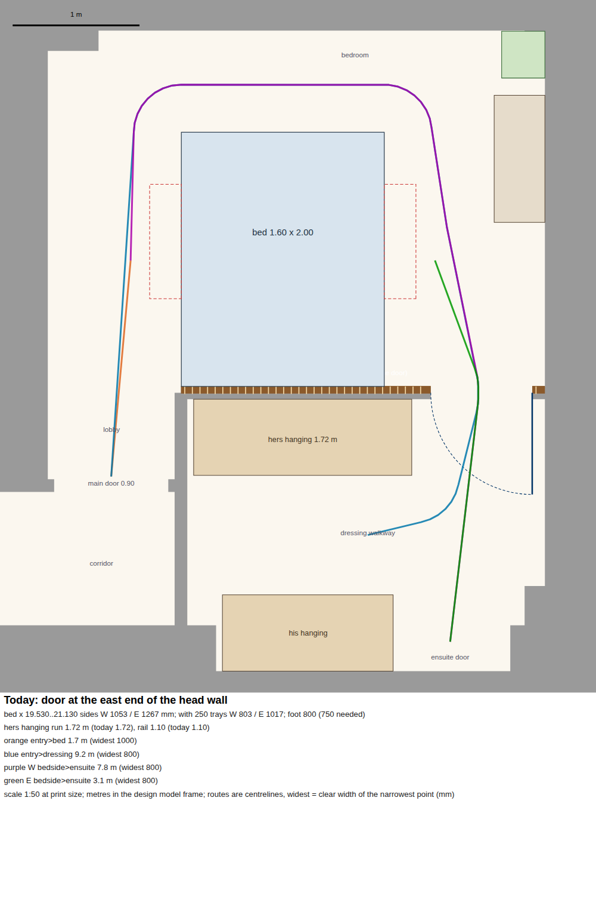
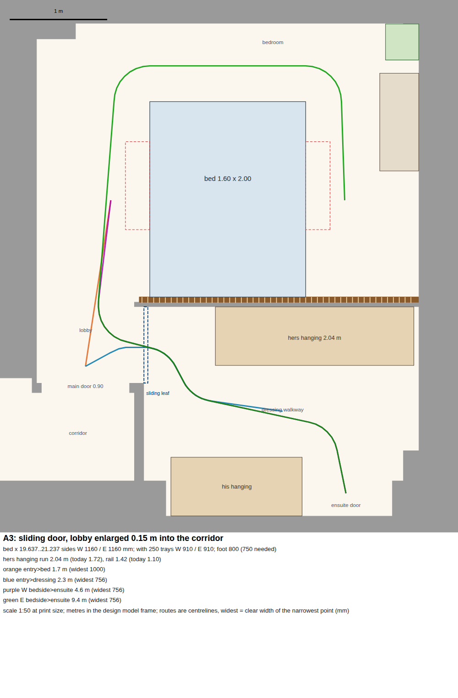
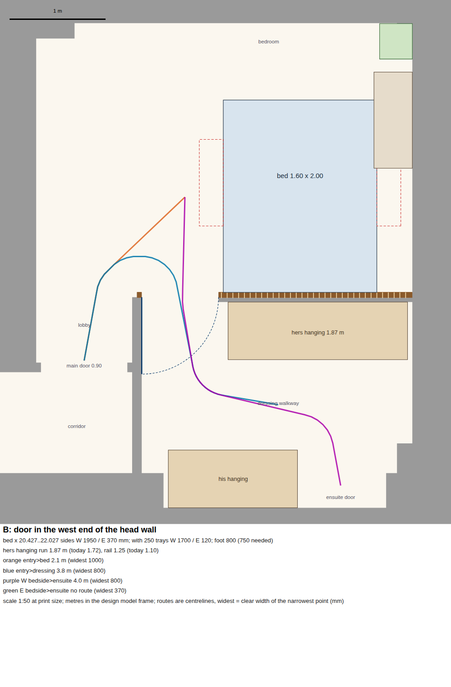
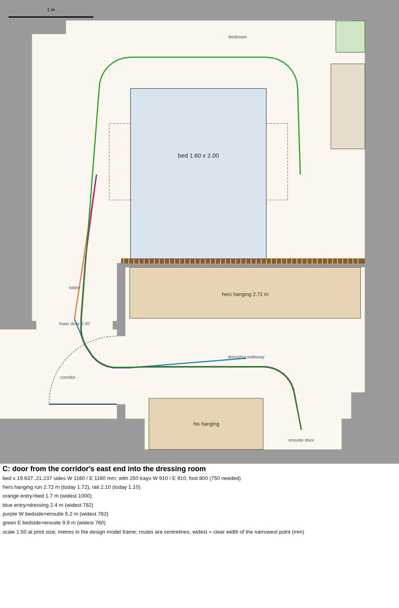
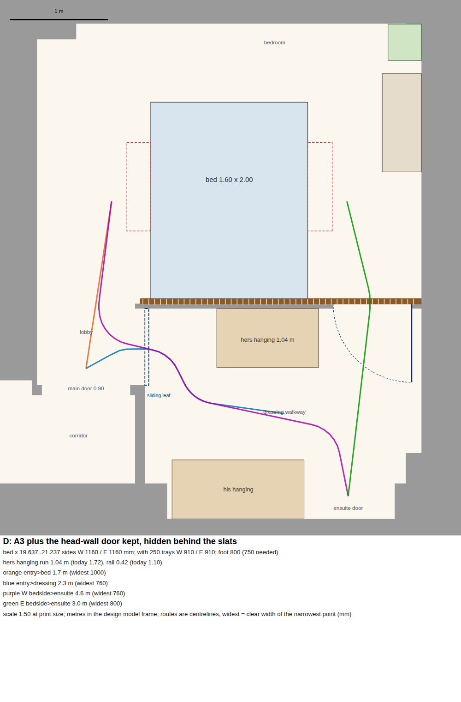

# Lane DF layout study: the parents' dressing-room door (2026-11-26)

**Proposal only. Nothing in the design model, the spec or the renders was changed.** Reproduce everything with
`python scripts/df_dressing_door_study.py` (writes `docs/lanes/DF-dressing-door-study/`; it has self-checks, see §6).

Client question: *"make the dressing room door near the main door rather than going all the way around the bed. Is that
a better design?"* plus: bed **centred**, the **whole** wall behind the bed as the wood-slat feature.

## 1. Answer in four lines
1. **Yes for arriving, no for the night trip, unless we pay for both.** Entry → dressing drops from **9.19 m to ~2.3 m** in every
   option that moves the door. Bed → ensuite from the **east** bedside (today 3.07 m) becomes **9.4 m**; from the west bedside it improves 7.84 → 4.62 m.
2. The lobby wall the client points at is **0.63 m between wall faces**, not the 0.73 m of the room polygon. A door there is **120 mm short of
   750 mm clear** unless the lobby is deepened 0.15 m into the corridor (option A3).
3. Moving the door to the head wall's west end (B) **cannot keep the bed**: the door needs the bed to start east of it and the east bedside falls to 0.37 m.
4. **Recommendation: A3**, with D as the client's one decision about the night route (§5).

## 2. Facts used (design model, clear faces, metres)
Taken from the `clear`/`net` polygons in `src/archpipe/model/data/d1-elements.json` (walls are 100 mm on their axes, so faces are 50 mm in from the axes quoted in the brief).

| Space | Clear extent | Note |
|---|---|---|
| Bedroom | x 18.477–22.397, y -26.591..-23.791 | head wall face y -26.591 |
| Lobby (parents-entry) | x 18.477–19.477, y -27.321..-26.641 | **1.00 × 0.68**, open to the bedroom on its north side |
| Dressing | x 19.577–22.397, y -28.671..-26.691 | wall to the lobby x 19.577 face; the shared wall is only y -27.321..-26.691 = **0.63 m** |
| Corridor (east end) | y -28.471..-27.421 = **1.05 m** wide, ends at x 19.477 | its east end wall (1.05 m) is also the dressing's west wall |
| Hanging today | `furn-pd-hang-1` x 19.627–21.347 = **1.72 m run** (long-hang .65 + double-hang .45 = **1.10 m rail**, drawers .42, hat-shelf .20); `furn-pd-hang-2` 1.346 m (his, rail .55 + .25 trouser pull-out) | unchanged in every option |
| Bed today | x 19.53–21.13 (centre 20.33): not centred on the room (20.437) nor the slat wall (20.962) | sides W 1.053 / E 1.267 |

## 3. Sources (project evidence cards, `knowledge/library.json`; all "original page checked" by the project, **not re-read by me**)
The book search index (`scripts/knowledge.py`, `semantic.py`) returned **0 hits on this machine** (empty index), so I could not open the books today.
I used only figures that already have a verified card, and invented none.
| Figure | Card | Source |
|---|---|---|
| Door clear opening 750 mm; corridor 900 head-on, 1200 not head-on (800 clear: 900) | `ukadm-door-750-corridor-headon`, `-corridor-side`, `ukadm-door-800-corridor-side` | UK AD M vol.1 M4(2) Table 2.1, p.17 |
| Clear width is measured with the leaf at 90 degrees | `ukadm-clear-opening-90deg` | AD M App. A, p.51 |
| Hall/landing 900 | `ukadm-hall-min-m42` | AD M M4(2) 2.22a, p.17 |
| Bedroom route 750; principal bed 750 **both sides** and foot; bedside furniture allowed in the 600 mm head zone | `ukadm-bedroom-route-750`, `ukadm-bed-principal-750`, `ukadm-bedside-zone-a-600` | AD M 2.25a/b, pp.18-19 |
| Path of travel 914 | `mitton-path-of-travel-min` | Mitton, Residential Interior Design 4th ed., p.68 |
| Hanging depth 600; walk-in door 550 (US 610 min); long-hang drop 1600 | `neufert-wardrobe-hanging-depth-600`, `-walkin-door-min-550`, `neufert-longhang-drop-1600` | Neufert 2nd Eng. ed. 1980, p.73-74 |
| Approach strip 0.30 m deep × door width each side of every door | project rule `villa_furnish._door_approaches` | project method, not a book figure |
AD M is England guidance used as a benchmark; with no jurisdiction pack this is guidance, not code compliance. The 750 route/bed figures apply because the brief records ageing in place.

## 4. The options
Plans are 1:50 at print size (SVG, with a PNG beside each). Coloured lines: orange entry→bed, blue entry→dressing, purple west-bedside→ensuite, green east-bedside→ensuite.
Routes are the shortest centreline that a **0.75 m wide** body can travel (the router uses an exact visibility graph on the plan eroded by 0.375 m); where no 750 route exists the line is drawn at the widest width available and the width is stated.
Furniture is the plan pieces only (bed with trays closed, vanity, plant, both hangings); soft cloth is not included (measured duvet overhang 0.10 m E / 0.14 m W, `model/circulation.py`, would take that off each side gap).
Bed centring: both bedsides must keep ≥750 mm even with a tray out 250 mm.

### A: door from the lobby, in the wall x 19.577 (`plan-A2.svg`, `plan-A3.svg`)
* **A1 hinged**: the opening is **0.63 m** between faces (corridor-wall face to head-wall face). A leaf of 0.60 clear fails 750 (short by 0.12) and would swing into the end of the wardrobe. Rejected.
* **A2 sliding, lobby unchanged**: same 0.63 m opening, leaf slides on the dressing side along the solid corridor-end wall (a pocket does not fit a 100 mm wall that is 0.6 m long). Still 0.12 short of 750; the widest body that gets through is 0.63 m. Fails the benchmark.
* **A3 sliding, lobby enlarged 0.15 m south**: move the 1.1 m of corridor wall at the lobby (wall-GF-int-23, x 18.427–19.527) from y -27.371 to -27.521. Opening becomes **0.78 m** (clear 750 route measured **0.756**). Lobby 1.00 × 0.83. **Cost to the corridor: its last 1.1 m narrows 1.05 → 0.90 m**, exactly the 900 benchmark, zero margin; no further than that. The 900 pocket door moves with its wall. The two approach strips (0.30 m each side) are free.
  **Cost to the dressing room:** the doorway opens straight onto the wardrobe end, so the hers hanging must start at x 20.31 (found by search: the first start that lets a 750 body turn south into the walkway). But the head-wall door is gone, so the run can extend east to 22.347.
  *Bed:* centred on the room, x 19.637–21.237: sides **1.16 / 1.16**, trays out 0.91 / 0.91, foot 0.80. Centred on the slat wall instead (x 20.162–21.762) the east side is **0.635 (0.385 with a tray)**, which fails; so the bed is centred on the room (the window is centred 0.12 m east of that, 20.557).
  *Slats:* head wall unbroken from the lobby jamb (x 19.527) to the east wall (22.397) = **2.87 m**. It is not "corner to corner": its west end is the open lobby edge, not a corner. The bedroom's full back wall is 3.92 m and the lobby opening cannot close.

### B: door in the west end of the head wall (`plan-B.svg`)
Opening x 19.577–20.377 (0.80), swing into the dressing room, hers hanging 20.477–22.347 (1.87 m, +0.15). The bed must start east of the door (0.05 beyond the far jamb, x 20.427–22.027) or it covers the opening. **East bedside 0.37 m, 0.12 m with a tray out: it fails the 750 on both sides rule by 0.38 m** and the east side has no 750 route at all. The head wall is broken at the west end, so the slat wall is **not** whole, and the bed is 1.5 m off the room centre. B is rejected.

### C: a door at the corridor's east end into the dressing room (`plan-C.svg`)
Door x 19.477–19.577, y -28.30..-27.50 (0.80), hinged south and swinging **out** into the corridor (against the south wall; in-swing would block the walkway), 0.9 m from the main door. Head wall solid (2.87 m slats), bed centred as in A3, hers hanging the full wall **2.72 m** (rail 2.10). No change to lobby or corridor. Costs: the dressing room and the ensuite (through the dressing-ext door) open off the villa corridor, so the suite loses its single private entrance, and the night trip from a bedside goes out through the lobby and the **corridor** (5.2 m from the west bedside, 9.95 m from the east). One 23 × 69 mm clip of the approach strip on the end of his hanging (shift it 30 mm). Not recommended on privacy alone.

### D (better combination found): A3 plus the old head-wall door kept, hidden
Keep the door at x 21.497–22.297 but make it a flush slat-clad (jib) door, so the feature wall reads whole; add the A3 lobby door. Both routes become short: entry→dressing 2.33 m and **east bedside→ensuite 3.04 m** (west 4.63 m). Cost: the wardrobe loses the head-wall run east of the door zone: hers hanging **x 20.31–21.347 = 1.04 m (rail 0.42, today 1.10)**, which is -0.68 m run and -0.68 m rail. Recoverable only by a wardrobe on the east wall (0.9 m) which was not drawn. Plus the lobby move of A3.

## 5. Comparison (metres; "route" = shortest centreline of a 750 body; the number in brackets is the narrowest width on it, mm)
| | Today | A2 (lobby sliding) | **A3 (recommended)** | B (head wall W) | C (corridor end) | D (A3 + hidden old door) |
|---|---|---|---|---|---|---|
| Door clear opening | 800 head wall | **630 (fails 750)** | 780 | 800 | 800 out-swing | 780 + 800 |
| Entry → bed (W side) | 1.71 | 1.72 | 1.72 | 2.09 | 1.72 | 1.72 |
| Entry → dressing | **9.19** (800) | 2.38 (**630**) | **2.32** (756) | 3.80 (800) | 2.35 (782) | 2.33 (760) |
| Entry → ensuite | 9.55 | 3.49 | 3.49 | 4.98 | 3.51 | 3.50 |
| Bed W side → ensuite (night) | 7.84 | 4.47 (630) | **4.62** | 4.00 | 5.20 | 4.63 |
| Bed E side → ensuite (night) | **3.07** | 9.05 (630) | **9.39** | no 750 route (0.37) | 9.95 | **3.04** |
| Bed on a solid head wall, slat wall whole | no (door) | yes, 2.87 m | yes, 2.87 m | no, door at the end | yes, 2.87 m | yes if the door is flush-clad |
| Bed position (x) | 19.53–21.13, off centre | 19.637–21.237 centred | 19.637–21.237 centred | 20.427–22.027, forced | 19.637–21.237 centred | 19.637–21.237 centred |
| Bedsides W / E (needs 750) | 1053 / 1267 | 1160 / 1160 | 1160 / 1160 | 1950 / **370** | 1160 / 1160 | 1160 / 1160 |
| Both trays out 250: W / E | 803 / 1017 | 910 / 910 | **910 / 910** | 1700 / **120** | 910 / 910 | 910 / 910 |
| Foot (needs 750) | 800 | 800 | 800 | 800 | 800 | 800 |
| Hers hanging run / rail (today 1.72 / 1.10) | 1.72 / 1.10 | 2.02 / 1.40 | **2.04 / 1.42** | 1.87 / 1.25 | 2.72 / 2.10 | 1.04 / 0.42 |
| His hanging | 1.346 | same | same | same | same | same |
| What is lost | short night route east side | fails 750 | night route east side 3.07→9.39; corridor end 1.05→0.90; 1 wall moved | the bed, both-sides access, whole slat wall | suite privacy, night route via the corridor | 0.68 m of rail; lobby wall move |
Hanging rail = run less the drawers and hat shelf (0.62 m) kept in the run. Today's route widths are limited by the 0.80 m foot passage (matches `docs/lanes/DF.md`: 0.78 with the tucked chair).

## 6. Checks on the numbers
* The router reproduces today's known pinch: widest route entry→dressing **0.80 m = the foot gap** (asserted in the script). Positive and negative cases are asserted: A2 must fail the 750 route, A3 must pass; B's east side must be under 750; A3's east side with a tray must be ≥ 750.
* Route lengths are exact shortest paths in the visibility graph (not grid steps); a hand estimate of today's long way (0.7 + 2.4 + 2.5 + 2.4 + 1.5 m) gives ~9.5 m against 9.19.
* Not done: Revit/Blender checks, curtain stacks and duvet cloth (the 0.10–0.14 m cloth sensitivity is not applied), noise/privacy tests, cost estimate, structural check of moving the corridor wall (it is an interior 100 mm partition per the model).

## 7. Recommendation
**Adopt A3** if the client accepts that **the person sleeping on the east side gets a 9.4 m trip to the ensuite** (today 3.07 m). It gives the short arrival the client asked for (9.19 → 2.32 m), a solid head wall, a bed centred in the room with both bedsides and both trays ≥ 0.91 m, and +0.32 m of hers hanging (2.04 m run), at the cost of one 1.1 m wall section moving 0.15 m and a sliding door. If the night trip matters more than 0.68 m of hanging, take **D** instead. Do **not** take B (the bed cannot sit) or C (suite privacy). The only clean answer to "is it a better design" is "better for coming home, worse for the east side at night, and only A3/D fix a 750 route at all"; the question to put to the client is **which side each of them sleeps on**.

## 8. Decisions I made (nothing here is applied)
1. Bed centred on the **room** (x 20.437), not on the slat wall: the slat wall's 2.87 m cannot give 750 on both sides.
2. Interpreted "main door" as the corridor door into the lobby; the entry point of all routes is its centre.
3. Used clear (face to face) dimensions, not the room-polygon axes, for every door.
4. A3 moves the wall by exactly 0.15 m: the most that leaves the corridor at its 900 benchmark.
5. Left hers hanging start in A3 at the first x that passes a 750 body, so the wardrobe layout (modules) is not re-planned.
6. Did not edit the model, `villa_furnish`, `PB_BED_X`, the slat/wall-fitting binding, tests or any shared file, because the brief said proposal only; moving the bed will unbind the lead-approved wall fittings (`PB_BED_X` note in `villa_furnish.py`).
